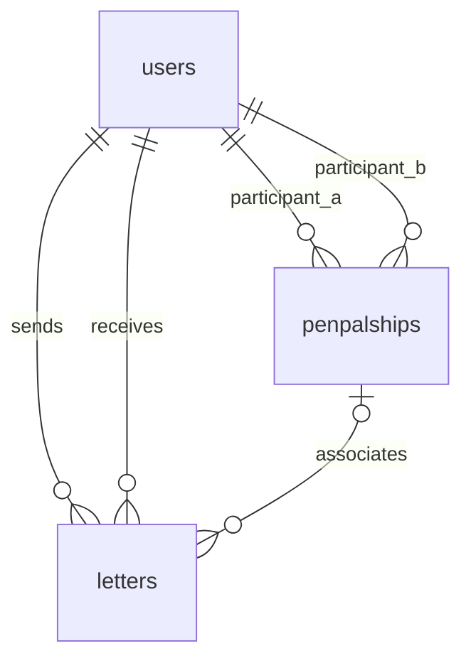

# Stage 2 database and SQL

The November 11, 2026 scope replaces the older eight-table product plan.

## Schema

All primary keys are generated `bigint` identities. All application timestamps
are `timestamptz`.

| Table | Columns |
|---|---|
| `users` | `id`, unique nonempty `username`, unique nonempty `email`, nonempty `display_name`, `created_at` |
| `penpalships` | `id`, `user_a_id`, `user_b_id`, `status` (`active`/`ended`), `created_at` |
| `letters` | `id`, `sender_id`, `recipient_id`, nullable `penpalship_id`, nonempty `subject`, nonblank `body`, `mode`, `status`, `created_at`, `updated_at`, nullable `send_at`, `deliver_at`, `delivered_at` |



`sender_id` and `recipient_id` are NOT NULL foreign keys, so every letter has
exactly one existing sender and recipient. They must differ. Pen-palship IDs
also reference an existing row. Default foreign-key deletion behavior preserves
referenced users and pairs; letter deletion never deletes its users or pair.

The `canonicalize_penpalship_row` trigger swaps reversed IDs before insertion or
update. `CHECK(user_a_id < user_b_id)` rejects self-pairs, and the unique pair
constraint prevents reversed duplicates. Once letters reference a pair, its
participants cannot be changed.

A letter is `direct` with a NULL pen-palship, or `penpal` with a non-NULL one.
`guard_letter_row` checks that sender/recipient are exactly that pair's two users,
in either direction. It takes a shared row lock while checking membership, so
participant changes cannot invalidate a concurrent letter write.

The same trigger rejects UPDATE and DELETE when the old status is not `draft`.
Thus in-transit and delivered rows cannot be edited, deleted, or reset to draft
through ordinary SQL. On a permitted update it sets `updated_at` automatically.
Only the statuses `draft`, `in_transit`, and `delivered` are allowed. This app
creates drafts only; it does not implement status transitions or delivery.

## Queries and transactions

- `backend/app/queries.py`: parameterized INSERT, guarded UPDATE/DELETE, and the
  report CTE. User values use `%s` parameters, never SQL interpolation.
- `backend/app/routers/mailbox.py`: SELECTs for users/options, validated filter
  parameters, current demo identity, and 404/409/422 error handling.
- `backend/migrations/001_stage_two.sql`: schema, triggers, and SQL word-count
  function. Every object is removed by its rollback pair.
- `backend/seed.sql`: repeatable fixture INSERTs; values are synthetic examples.

Writes set the sender from `user_id`; request bodies cannot supply sender/status.
UPDATE/DELETE include `id`, `sender_id`, and `status = 'draft'` in the SQL WHERE
clause. Another identity receives 404; an owned non-draft receives 409. Constraint
failures receive 422 after rolling back the statement transaction. These checks
scope the demo workflow; they do not authenticate the person selecting an ID.

Psycopg pool connections use autocommit-off contexts. Explicit transaction blocks
protect writes, and the connection dependency runs with FastAPI function scope:
its commit completes before the response is sent. Each application lifespan gets
a fresh pool. Failed constraints leave the existing letter unchanged.

## Word count and report

`letter_word_count(body)` is a PostgreSQL SQL function. It trims leading/trailing
whitespace and splits on one or more whitespace characters. Blank/NULL input
returns zero; hyphenated words count as one token. Blank persisted bodies are
separately prohibited by the table constraint.

```sql
SELECT letter_word_count(E' one  two\nthree\t '); -- 3
```

The report CTE selects `sender_id = user_id OR recipient_id = user_id`, then
applies optional correspondent/mode/status/date filters. A correspondent can be
either the sender or recipient. UTC creation-date ranges include the first day
and use an exclusive midnight after the last day. Invalid reversed ranges return
422. Results sort by newest creation timestamp, then ID.

A single statement calculates `COUNT(*)`, `AVG(word_count)` rounded to one decimal,
`COUNT(*) FILTER (WHERE is_sent)`, and the received count. `jsonb_agg` returns the
same matching rows. Two many-to-one joins resolve user names: no recipients or
tags junction can duplicate a letter. Count and table contents share a PostgreSQL
statement snapshot. Empty results use zero counts/average and an empty array.

## Database-populated UI

`/users` selects identities from `users`. `/options` selects all other users as
recipients/correspondents, the current user's active pairs, and DISTINCT modes
and statuses from that user's letters. The frontend supplies only display labels
and the generic “All” options. The compose form's two mode choices are fixed
schema values; report mode/status options are query results.

Mutations await invalidation/refetch of `['report', user_id]` and
`['options', user_id]`. Filter values are part of report query keys. Switching
identity resets local form/filter state and uses that identity's query keys.

## Indexes

- `(sender_id, status, created_at)`: outgoing mailbox/report filtering.
- `(recipient_id, status, created_at)`: incoming mailbox/report filtering.
- `(penpalship_id)`: finding existing references when protecting pair participants.
- Primary keys and unique constraints supply their own indexes.

On eighteen rows PostgreSQL may reasonably prefer a sequential scan. An example
inspection command in a database console is:

```sql
EXPLAIN (ANALYZE, BUFFERS)
SELECT id FROM letters
WHERE (sender_id = 1 OR recipient_id = 1) AND status = 'draft'
ORDER BY created_at DESC, id DESC;
```

No performance claim is made from the small demo dataset. Advanced metrics,
authentication, delivery jobs, invites, and memory-permission queries are excluded.
